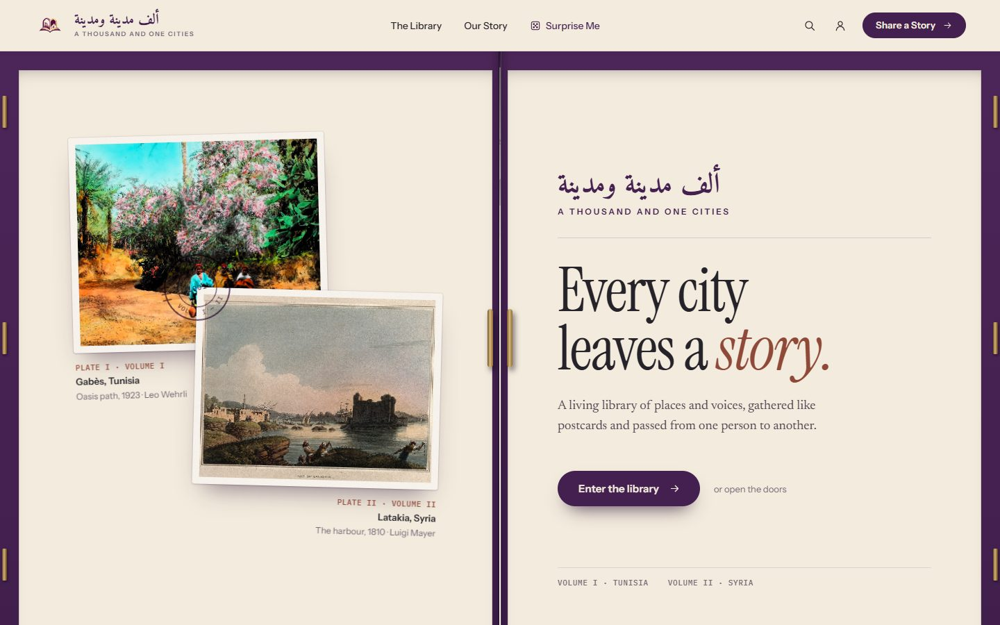
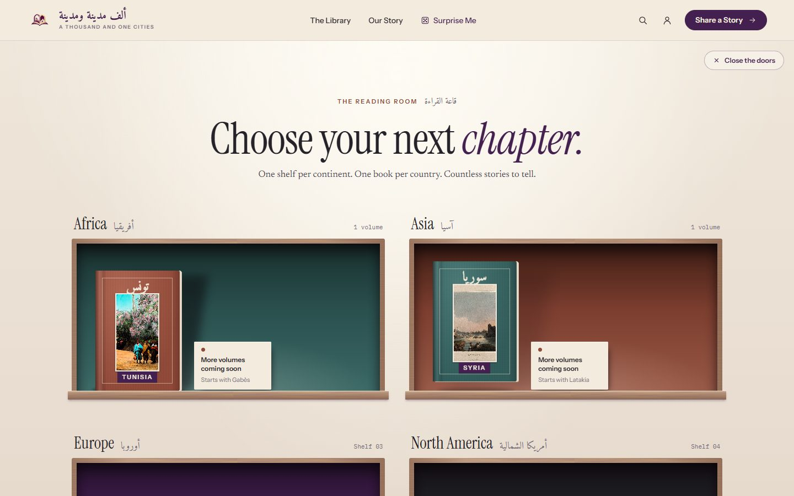
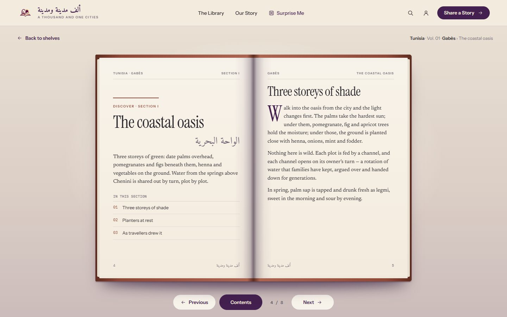
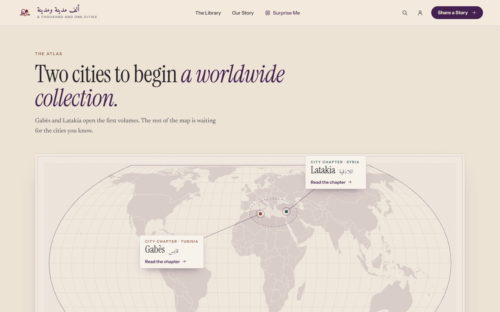
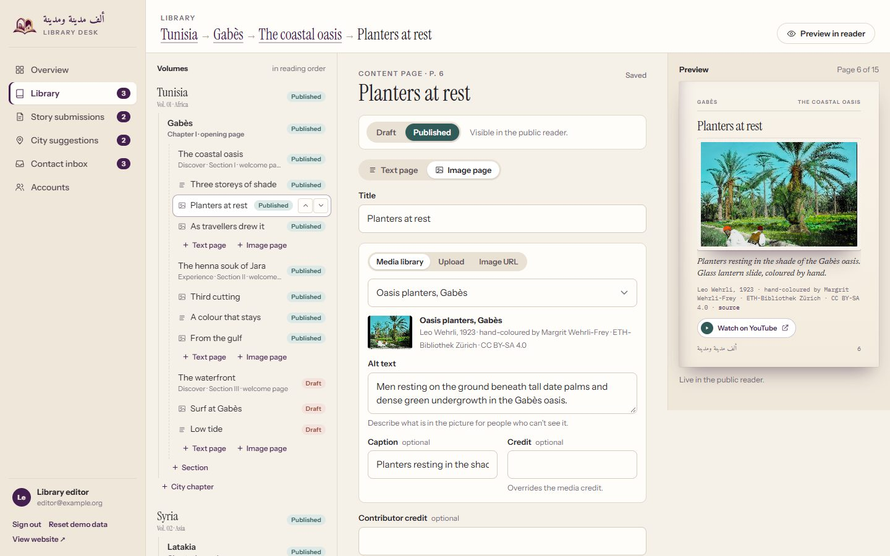
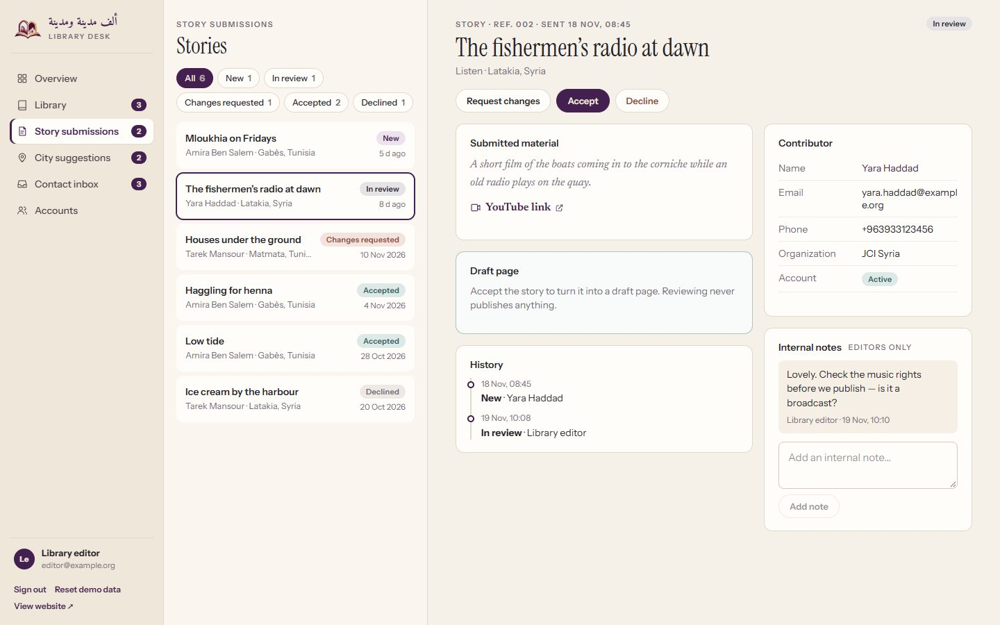
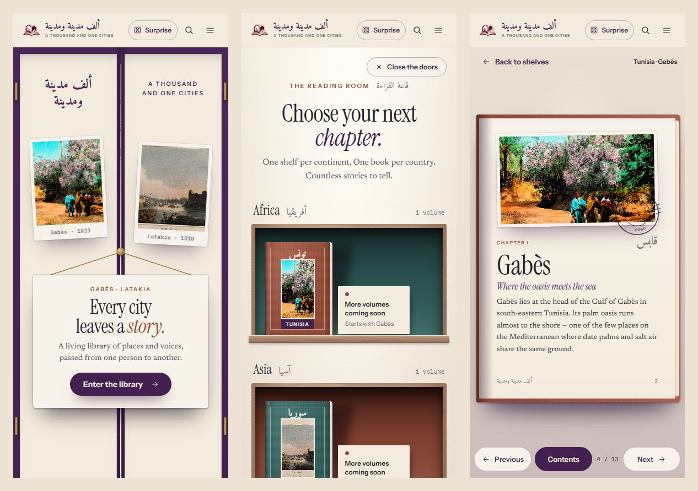

<div align="center">


# ألف مدينة ومدينة · A Thousand and One Cities

**A living library of cities.** Continents are shelves, countries are books, cities are
chapters, and every contribution is a new page.

React 18 · Vite 6 · React Router 6 · Vitest · Puppeteer

</div>



Inspired by *One Thousand and One Nights*, the project presents cities the way the people
who live there experience them: food, music, places, crafts, traditions, journeys and the
secrets locals keep. It starts with **Gabès** (Tunisia) and **Latakia** (Syria), a joint
project of JCI ENIG Gabès Sud and JCI Syria, and is built to grow one city at a time.

This repository holds the **frontend**: the public website and the editors’ **library
desk** (admin). All data goes through one API layer, which is backed by a browser-persisted
mock today and is shaped like the REST API of the planned Node + MongoDB backend.

---

## Contents

- [Features](#features)
- [Screenshots](#screenshots)
- [Getting started](#getting-started)
- [Test accounts](#test-accounts)
- [Scripts](#scripts)
- [Project structure](#project-structure)
- [Architecture](#architecture)
- [Business rules](#business-rules)
- [Testing](#testing)
- [Accessibility and responsiveness](#accessibility-and-responsiveness)
- [Deployment](#deployment)
- [Roadmap](#roadmap)
- [Credits](#credits)

## Features

### Public website
- **The entrance**: a double door that swings open onto the reading room, where every
  continent shelf is visible together. Books lift off the shelves when chosen.
- **The reader**: each country is a book with a cover, a generated contents page, city
  chapter openers, section welcome pages and story pages. Turn pages with Previous/Next,
  by clicking the left or right page, by swiping on a phone, or with the arrow keys.
- **Finding cities**: search (English or Arabic), *Surprise Me*, and a printed-style
  world atlas linking each published city to its chapter.
- **Contributing**: share a story (text, photograph or video link), suggest a city, or
  write to the editors. Every submission gets a reference and a status.
- **Contributor accounts**: registration (name, email, phone, city, country and more),
  email and password sign-in, and an account page showing each submission’s status and
  the editors’ messages.

### Library desk (`/admin`)
- **Overview**: what awaits review, open messages, drafts and recent activity.
- **Library editor**: volumes, city chapters, sections and pages, with ordering,
  publication state, autosave and a live page preview.
- **Review queues** for story submissions and city suggestions: accept, decline, request
  changes, internal notes, and one click to turn an accepted record into draft content.
- **Contact inbox** with internal notes and draft replies, and **Accounts** with search,
  profiles, activity and status.

## Screenshots

| Reading room | Reader |
|---|---|
|  |  |
| **Atlas** | **Library editor** |
|  |  |
| **Story review** | |
|  | |

On a phone the same pages adapt: one shelf per row, a hanging sign on the doors, and a
single-page reader.



## Getting started

Requirements: **Node.js 20+** and npm.

```bash
git clone <your-repository-url> alf-madina
cd alf-madina
npm install
npm run dev
```

Open <http://localhost:5178>. The library desk is at <http://localhost:5178/admin>.

> **Windows:** if the project folder name contains `&`, npm scripts can fail. Rename the
> folder, or run `node node_modules/vite/bin/vite.js` directly.

## Test accounts

Test credentials for the editor and the seeded contributors are in
[`docs/test-accounts.md`](docs/test-accounts.md).

While testing, the sign-in pages also show two shortcut buttons, **Sign in as test user**
(at `/account`) and **Sign in as test editor** (at `/admin/login`). Turn them off before
launch by setting `TEST_ACCESS.enabled` to `false` in [`src/config.js`](src/config.js).
The API then refuses the shortcuts as well.

> **These accounts are demo data, not security.** Passwords are checked in the browser
> against salted hashes in the seed. Real authentication (bcrypt, server sessions or JWT,
> rate limiting, password reset, email) belongs to the backend.

## Scripts

| Command | What it does |
|---|---|
| `npm run dev` | Start the dev server on port 5178 |
| `npm run build` | Production build into `dist/` |
| `npm run preview` | Serve the production build locally |
| `npm test` | Unit tests (Vitest) |
| `npm run test:watch` | Unit tests in watch mode |
| `npm run test:e2e` | End-to-end checks in headless Chrome (start `npm run dev` first) |

## Project structure

```
src/
├── domain/        Pure business rules: no React, no storage, unit-tested
│                  library.js (reading order, publication, search, shelves)
│                  workflow.js (review states) · validation.js · media.js · constants.js
├── api/           The data boundary used by every screen
│   ├── index.js   Exports `api`; today backed by the mock
│   └── mock/      Mock REST handlers over a persisted store
├── data/seed/     Fixtures: library content and review records (fictional people)
├── hooks/         useApi (load and stay fresh) · useAction (writes) · useTitle
├── ui/            Shared components: form fields, dialogs, badges, toasts, icons
├── features/      Screens, grouped by feature
│   ├── home/  reader/  forms/  account/  about/  layout/
│   └── admin/ overview · library · stories · suggestions · inbox · accounts
├── app/           Router and not-found page
├── styles/        Design tokens (index.css) and stylesheets per area
└── config.js      Test-access switch
tests/
├── unit/          Vitest
└── e2e/           Puppeteer flows for the definition of done
docs/
├── data-model.md  Proposed MongoDB collections, fields, relationships and indexes
├── api.md         The endpoint behind each `api.*` method
├── test-accounts.md
├── screenshots/
└── proposal/      Source of the revised project proposal (PDF in docs/)
```

### Routes

| Public | Admin |
|---|---|
| `/` entrance, atlas and contribution | `/admin/login` |
| `/books/:volume` and `/books/:volume/:city` | `/admin` overview |
| `/our-story` | `/admin/library?node=…` |
| `/share-a-story` · `/suggest-a-city` · `/contact` | `/admin/stories/:id` · `/admin/suggestions/:id` |
| `/account` (sign in, register, profile) | `/admin/inbox/:id` · `/admin/accounts/:id` |

## Architecture

```
features  →  hooks / ui  →  api  →  domain
```

- **Domain** functions are pure and shared by the mock API and the screens. For example,
  the reading order (cover → contents → chapter opener → section welcome → pages), page
  numbers and the contents page are derived there, never stored.
- **API**: screens only call `api.*`. Each method maps to a REST endpoint
  ([docs/api.md](docs/api.md)). The mock adds latency, returns copies, enforces editor-only
  access, and persists to `localStorage`. To connect the backend, replace
  `createMockApi` in `src/api/index.js` with an HTTP client of the same shape.
- **Hooks**: `useApi(fetcher)` handles loading and error states and re-fetches when data
  changes; `useAction()` wraps writes and reports errors.
- **Lazy loading**: the admin, secondary pages and the atlas (with its map data) are
  loaded on demand.

### Data and persistence

The proposed data model is in [docs/data-model.md](docs/data-model.md). In this frontend,
data lives in the browser’s `localStorage` (`alf-madina:db`, plus the contributor and
editor sessions). It survives reloads, is shared between tabs, and is replaced when the
seed version changes or an editor chooses **Reset demo data** in the admin sidebar.

## Business rules

- A chapter is always a city. A section’s welcome page is generated from the section and
  sits directly before its pages. The contents list city chapters only.
- **Only published content is public.** A page under a draft section, chapter or volume
  stays out of the reader, contents, search, atlas and shelves. Editors can preview drafts.
- **Review is separate from publishing.** Accepting a story or city suggestion makes it
  eligible to become a draft; publishing is a separate step in the Library. Creating a
  draft from the same record twice opens the existing draft.
- Contributors see their submissions’ status and the editors’ messages, never internal notes.
- Contact replies are saved as drafts; nothing is ever reported as sent.
- Image pages need alt text before publishing. Videos are links only (YouTube, Instagram
  Reel, Facebook Reel); images are JPG, PNG or WebP up to 2 MB in the demo.
- Accounts require name, email, phone number, city and country; organization and a short
  description are optional.

## Testing

```bash
npm test             # unit tests
npm run dev          # in one terminal
npm run test:e2e     # in another
```

- **Unit tests** cover the reading order, publication rules, search, review transitions,
  idempotent drafts, validation, sign-in and access control.
- **End-to-end tests** drive a real browser at desktop and phone widths through the full
  journey:
  - the doors, shelves, reader, contents and page turns
  - Surprise Me, search and the atlas
  - submitting a story, a city suggestion and a message, then managing all three in Admin
  - building and publishing a new chapter, and checking it in the public book, contents and search
  - registration, sign-in and the test buttons
  - checks after reloading

  Set `CHROME_PATH` if Chrome or Edge is not in a standard location, and `E2E_URL` to
  test another address.

## Accessibility and responsiveness

- One responsive layout from 320 px phones to wide desktops; no separate mobile site.
- Semantic landmarks, labelled controls, visible focus, keyboard page turns, a skip link,
  accessible dialogs, and alt text on every image.
- `prefers-reduced-motion` replaces the door swing and page turns with fades.

## Deployment

`npm run build` produces a static site in `dist/`. Host it on any static host (Vercel,
Netlify, GitHub Pages with a 404 fallback, Nginx…) **with single-page-app fallback**, so
deep links like `/books/tunisia/gabes` serve `index.html`.

Before a public launch:
1. set `TEST_ACCESS.enabled = false` in `src/config.js`;
2. connect the backend and replace the demo sign-in;
3. copy the Wikimedia images into `public/media` (they are hotlinked today).

## Roadmap

- **Backend** (Node + Express + MongoDB Atlas + Cloudinary), following
  [docs/data-model.md](docs/data-model.md) and [docs/api.md](docs/api.md).
- Real authentication, email delivery of replies, password reset.
- Audio stories and structured itineraries (e.g. *100 TND · one day in Gabès*).
- More cities through the “Does your city deserve a chapter?” challenge.

## Credits

- Concept and campaign: JCI ENIG Gabès Sud and JCI Syria. The revised project proposal is
  [`docs/A Thousand and One Cities (english) - revised.pdf`](docs/A%20Thousand%20and%20One%20Cities%20(english)%20-%20revised.pdf).
- Photographs and prints from Wikimedia Commons, credited where they appear:
  - Leo Wehrli’s hand-coloured lantern slides of Gabès (1923, ETH-Bibliothek, CC BY-SA 4.0)
  - an 1887 engraving of the Gabès oasis (public domain)
  - DrRachT’s photographs of the Jara henna souk (CC0)
  - Luigi Mayer’s 1810 aquatint of Latakia harbour (Wellcome Collection, CC BY 4.0)
  - the Latakia tetrapylon (LorisRomito, CC BY-SA 3.0)
  - fishing boats off the Southern Corniche (Abd Alsattar Ardati, CC BY-SA 4.0)
- Map data: Natural Earth via `world-atlas`.
- Typefaces: Instrument Serif, Instrument Sans, Newsreader, Amiri, IBM Plex Mono and
  IBM Plex Sans Arabic (Google Fonts).

The repository does not include a license yet. Add one before publishing if others may
reuse the code.
